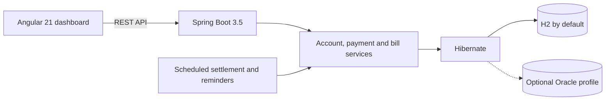

# EzPay

**A digital payments sandbox for UPI, bank transfers, and bill management.**

EzPay brings payment initiation, transaction tracking, and bill reminders into one dashboard. It pairs an Angular frontend with a Java and Spring Boot backend and includes a demo account that lets you try the complete simulated payment flow.

> [!IMPORTANT]
> EzPay runs locally with simulated funds. The application displays demo verification codes and password reset links so you can test the account flows without external services.

[Quick start](#quick-start) · [Demo walkthrough](#demo-walkthrough) · [Architecture](#architecture) · [Development](#development) · [Requirements specification](EzPay_BFSI.md)

## Features

| Area | Capabilities |
| --- | --- |
| Account management | Registration, multifactor sign-in, password recovery, profile editing, and notification preferences. |
| Payments | Simulated UPI payments and account-number/IFSC transfers, with a review step and additional verification for high-value payments. |
| Transaction history | Live status updates, receipts, search and filters, and a printable report that can be saved as PDF. |
| Bill management | One-time and monthly bills, upcoming and overdue views, reminders, and simulated bill payment. |
| Notifications | An inbox for confirmations, reminders, and fraud alerts, with optional desktop alerts while EzPay is open. |

## Quick start

Install **Java 17 or newer**, **Maven 3.6.3 or newer**, and **Node.js 22.12+ on the 22.x line or Node.js 24.x**, with npm.

From the repository root, build the Angular frontend and package it with the Spring Boot backend.

```bash
npm --prefix frontend ci
npm --prefix frontend run build
mvn -f backend/pom.xml clean package
cd backend
java -jar target/ezpay-1.0.0.jar
```

Open [http://127.0.0.1:8080](http://127.0.0.1:8080) and select **Open demo account**. EzPay creates a sandbox account with ₹50,000 in simulated funds and links both test payment methods. To try registration and MFA, select **Create an account** and use test contact details.

## Demo walkthrough

| To try | Use | Expected result |
| --- | --- | --- |
| Successful UPI payment | Send ₹100 to `recipient@demo` | The payment settles and its receipt appears in **Transactions**. |
| Successful bank transfer | Use account `123456789012`, IFSC `DEMO0000001`, and a transfer purpose | The transfer settles and appears in the same transaction history. |
| Provider decline | Send to `recipient@declined` | The payment fails and EzPay restores the reserved demo funds. |
| Bill reminder | Add a bill due within three days | A reminder appears in **Notifications**. |

## Architecture



The backend stores amounts in integer paise and binds retries to idempotency keys to prevent duplicate debits. It uses AES-GCM for private fields, BCrypt for passwords, and expiring HttpOnly cookies for sessions.

| Path | Contents |
| --- | --- |
| [`frontend/`](frontend/) | Angular application, styles, dev proxy, and npm lockfile. |
| [`backend/`](backend/) | Spring MVC API, transaction services, Hibernate models, and integration tests. |
| [`EzPay_BFSI.md`](EzPay_BFSI.md) | Page-by-page requirements, implementation decisions, and deployment dependencies. |

## Development

Run these commands from the repository root in separate terminals.

**Backend**

```bash
mvn -f backend/pom.xml spring-boot:run
```

**Frontend**

```bash
npm --prefix frontend ci
npm --prefix frontend start
```

Open [http://127.0.0.1:4200](http://127.0.0.1:4200). The [development proxy](frontend/proxy.json) forwards `/api` requests to port 8080. The packaged app uses H2 by default and stores its database and local encryption key under `data/` relative to the working directory. See the [configuration instructions](EzPay_BFSI.md#run-ezpay) for Oracle and managed key material.

### Verification

```bash
npm --prefix frontend run build
mvn -f backend/pom.xml test
```

The Angular build type-checks the UI and templates. The [integration tests](backend/src/test/java/dev/ezpay/WorkflowTest.java) use an isolated H2 database to check account recovery, session invalidation, payment retries, reversals, bill reminders, and additional payment verification.

## Production readiness

Live deployment requires approved UPI and bank integrations, SMS and email providers, push delivery while the app is closed, validation against Oracle, and production security, disaster recovery, capacity, and compliance assessments. The [requirements specification](EzPay_BFSI.md#production-dependencies) records those dependencies and the business requirements document’s availability and transaction-processing targets.
